# Jarkom-Modul-3-2026-K-27

## Member

| Nama | NRP |
| :--- | :--- |
| Muhammad Nadhif Pasya Ikhsan | 5027251084 |
| Akhdan Hafiz Anugrah | 5027251094 |

## Soal 1 — Konfigurasi Jaringan

Jichi menggunakan eth0 sebagai WAN DHCP dan eth1–eth4 sebagai gateway `10.77.1.1` sampai `10.77.4.1`, seluruhnya `/24`. IPv4 forwarding dan NAT MASQUERADE diaktifkan. Host infrastruktur menggunakan IP statis; tengen menggunakan `10.77.4.10/24` dengan gateway `10.77.4.1`.

```sh
# Jichi
sh /root/nomor1-jichi.sh
# Tengen; host lain menjalankan script sesuai nama node
sh /root/nomor1-tengen.sh
```

Pengujian dilakukan dengan memeriksa `ip addr`, `ip route`, serta ping dari setiap host ke gateway dan alamat eksternal yang relevan.

### Dokumentasi
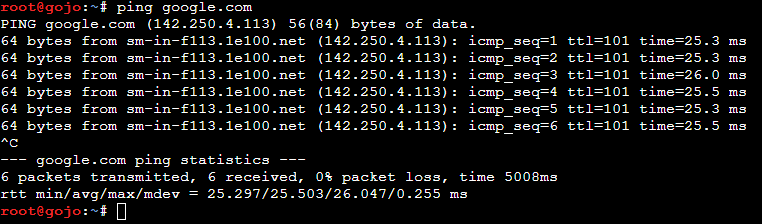

## Soal 2 — DHCP Server

ISC DHCP Server dipasang pada tengen. Network 4 dideklarasikan tanpa pool dinamis, sedangkan Network 2 dan 3 menyediakan alamat untuk client.

```sh
# Tengen
sh /root/nomor2-dhcp-server.sh
dhcpd -t -cf /etc/dhcp/dhcpd.conf
service isc-dhcp-server status
```

Validasi harus bebas error, termasuk `No subnet declaration`.

### Dokumentasi

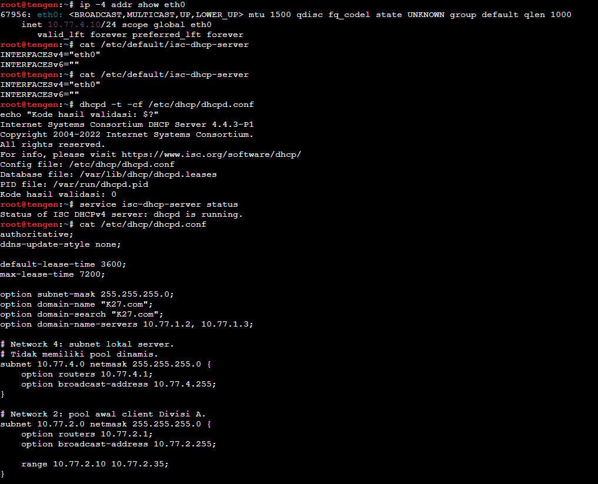

## Soal 3 — DHCP Relay

Jichi meneruskan permintaan DHCP dari eth2 dan eth3 ke tengen `10.77.4.10` melalui eth4. Client Alpine menggunakan DHCP pada eth0.

```sh
# Jichi
sh /root/nomor3-dhcp-relay.sh
# Setiap client Alpine
sh /root/nomor3-client.sh
```

Periksa alamat dan routing client dengan `ip addr` serta `ip route`. Client harus memperoleh alamat sesuai subnetnya dan dapat menjangkau gateway.

### Dokumentasi

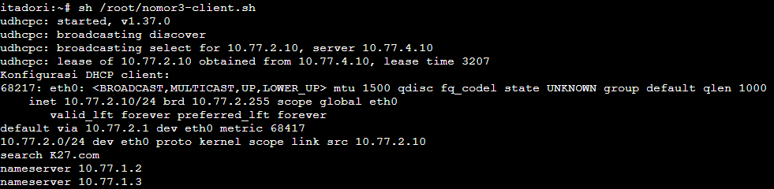

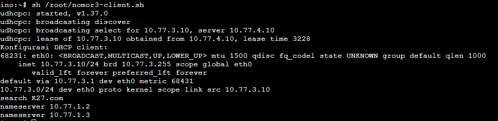


## Soal 4 — Pemisahan Pool Network 2

DHCP class berdasarkan MAC Address digunakan untuk membatasi alokasi:

| Client | Pool |
| --- | --- |
| itadori, fushiguro | 10.77.2.10–10.77.2.35 |
| zenin, okkotsu | 10.77.2.70–10.77.2.95 |

```sh
# Tengen
sh /root/nomor4-pool.sh
# Renew pada keempat client
sh /root/nomor3-client.sh
```

Cocokkan IP dengan pool masing-masing. Rentang `10.77.2.36–10.77.2.69` tidak dialokasikan.

### Dokumentasi

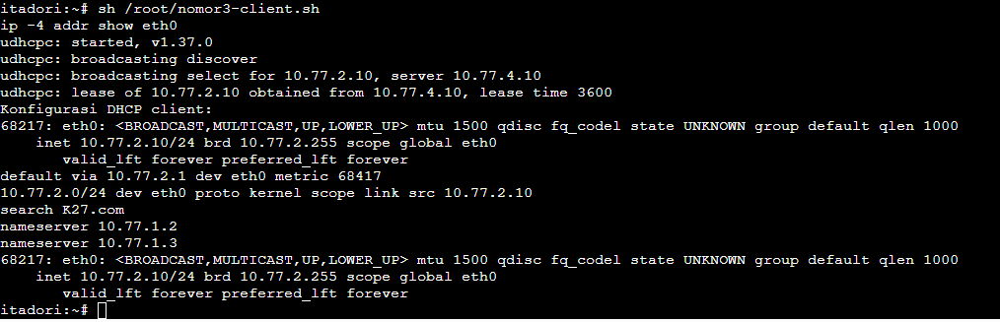

## Soal 5 — Durasi Lease Network 3

| Client | Pool | Lease |
| --- | --- | --- |
| ino, kusakabe | 10.77.3.10–10.77.3.89 | 1800 detik |
| miwa | 10.77.3.100–10.77.3.199 | 43200 detik |

Client menerima DNS `10.77.1.2`, `10.77.1.3`, dan domain-search `K27.com`.

```sh
# Tengen
sh /root/nomor5-lease.sh
# Renew pada client terkait
sh /root/nomor3-client.sh
cat /etc/resolv.conf
```

Periksa pool, DNS, dan durasi lease melalui lease server atau DHCPACK.

### Dokumentasi

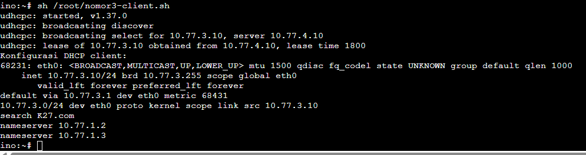

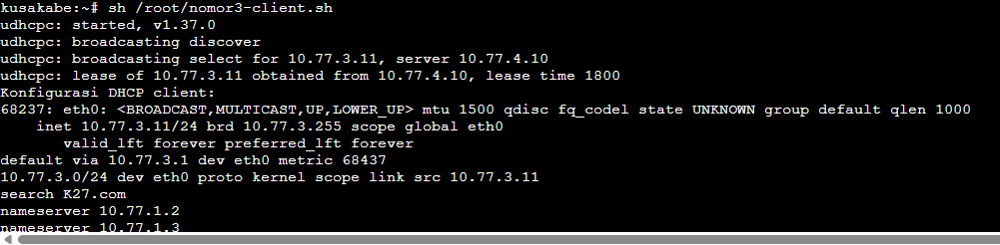

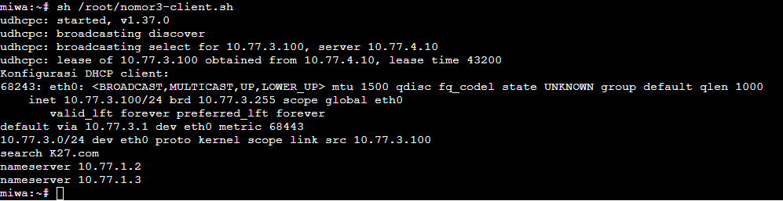


## Soal 6 — Reservasi Kugisaki

Kugisaki memperoleh fixed address `10.77.3.99` berdasarkan MAC Address. Alamat tersebut berada di luar seluruh pool dinamis.

```sh
# Tengen
sh /root/nomor6-reservasi.sh
dhcpd -t -cf /etc/dhcp/dhcpd.conf
# Kugisaki
sh /root/nomor3-client.sh
ip -4 addr show eth0
```

Setelah renew, kugisaki harus tetap memperoleh `10.77.3.99/24`.

### Dokumentasi

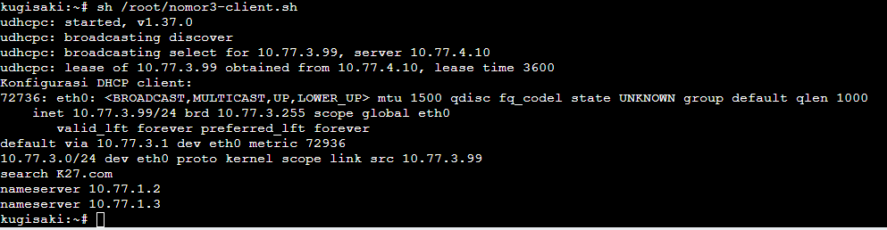

## Soal 7 — Verifikasi Client

Periksa seluruh client: IP sesuai pool, mask `/24`, gateway `10.77.2.1` atau `10.77.3.1`, broadcast sesuai subnet, serta DNS dan domain-search sesuai konfigurasi.

```sh
# Setiap client
sh /root/nomor7-check.sh
# Tengen
sh /root/nomor7-check-server.sh
cat /var/lib/dhcp/dhcpd.leases
```

Cocokkan MAC dan lease aktif; pastikan tidak ada IP duplikat. Reservasi kugisaki dibuktikan melalui konfigurasi host dan IP client karena fixed address tidak harus muncul dalam daftar lease dinamis.


## Soal 8 — Capture DORA

Capture dijalankan pada tengen, kemudian salah satu client meminta lease baru.

```sh
# Tengen: mulai capture
sh /root/nomor8-capture.sh capture
# Client: minta lease baru
sh /root/nomor3-client.sh
# Tengen: setelah menghentikan capture dengan Ctrl+C
sh /root/nomor8-capture.sh baca
```

Identifikasi urutan **DISCOVER → OFFER → REQUEST → ACK**, server `10.77.4.10`, alamat yang diberikan, dan lease time. Nilai `giaddr` harus `10.77.2.1` untuk Network 2 atau `10.77.3.1` untuk Network 3.

### Dokumentasi


## Soal 9 — Simulasi Gangguan Relay

Hentikan relay, lalu lakukan permintaan DHCP baru pada satu client. Script client membersihkan alamat lama agar kegagalan memperoleh lease terlihat.

```sh
# Jichi
sh /root/nomor9-relay.sh stop
# Client pengujian
sh /root/nomor9-uji-client.sh gangguan
# Jichi
sh /root/nomor9-relay.sh start
# Client pengujian
sh /root/nomor9-uji-client.sh pulih
```

Saat relay berhenti, permintaan lease baru gagal. Setelah relay aktif, client harus memperoleh alamat dari pool yang benar dengan gateway semula.

### Dokumentasi

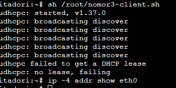

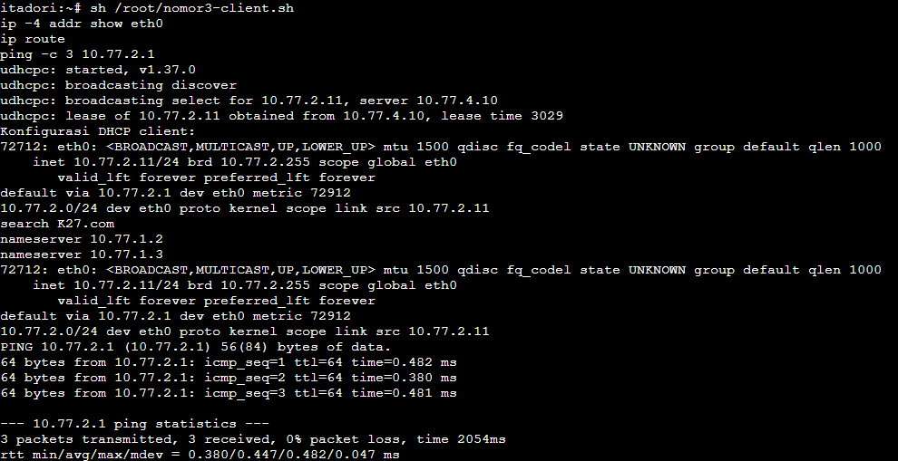

## Soal 10 — Autostart

Pada **jichi dan tengen**, jalankan script milik masing-masing node:

```sh
sh /root/nomor10-pasang-autostart.sh
```

Atur **Start command** kedua node di GNS3:

```sh
/bin/sh -c '/bin/sh /root/nomor10-autostart.sh >> /root/nomor10-boot.log 2>&1; exec /bin/bash'
```

Lakukan Stop/Start kedua node, lalu periksa layanan tanpa menyalakannya secara manual:

```sh
# Jichi
service isc-dhcp-relay status
# Tengen
service isc-dhcp-server status
# Setiap client setelah server siap
sh /root/nomor3-client.sh
sh /root/nomor7-check.sh
```

Pastikan pool, durasi lease, reservasi kugisaki, dan konektivitas tetap sesuai. Script konfigurasi nomor 1–6 tidak perlu diulang jika autostart berhasil.

## Dokumentasi


## Soal 11
Utahime dan Shoko ditugaskan membangun sistem penamaan domain resmi agar seluruh pos tidak perlu menghafal alamat IP mentah. Konfigurasikan BIND9 pada utahime sebagai DNS Master dan shoko sebagai DNS Slave untuk mengelola domain jujutsu.<xxxx>.com. Atur SOA record, NS delegasi untuk kedua server, dan terapkan allow-transfer dari Master ke Slave. Pastikan file zona berhasil tersinkronisasi otomatis ke shoko saat nomor serial di utahime dinaikkan, lalu buktikan dengan melakukan query dig ke kedua server dari salah satu client.

Jadi tujuan dari soal 11 sendiri yaitu membangun infrastruktur resolusi nama terdistribusi dan redundan menggunakan BIND9. Konfigurasi menempatkan `utahime` sebagai DNS Master yang memegang otoritas konfigurasi zona, serta `shoko` sebagai DNS Slave yang menyalin data zona secara berkala dan otomatis melalui mekanisme *zone transfer* (AXFR/NOTIFY).

Kemudian untuk langkah pengerjaannya sendiri disini kita melakukan konfigurasi pada `utahime`
```bash
echo "nameserver 192.168.122.1" > /etc/resolv.conf
apt-get update && apt-get install -y bind9 bind9utils dnsutils

cat << 'EOF' > /etc/bind/named.conf.local
zone "jujutsu.K-27.com" {
    type master;
    file "/etc/bind/db.jujutsu";
    allow-transfer { 10.77.1.3; };
    also-notify { 10.77.1.3; };
};
EOF

cat << 'EOF' > /etc/bind/db.jujutsu
$TTL    86400
@       IN      SOA     utahime.jujutsu.K-27.com. admin.jujutsu.K-27.com. (
                              2026101201 ; Serial
                                    3600 ; Refresh
                                    1800 ; Retry
                                  604800 ; Expire
                                   86400 ) ; Negative Cache TTL
;
@       IN      NS      utahime.jujutsu.K-27.com.
@       IN      NS      shoko.jujutsu.K-27.com.
;
utahime IN      A       10.77.1.2
shoko   IN      A       10.77.1.3
EOF

named-checkconf && named-checkzone jujutsu.K-27.com /etc/bind/db.jujutsu
pkill named 2>/dev/null || true; named -u bind
```
Setelah konfigurasi pada `utahime` sekarang lanjut ke `shoko`
```bash
echo "nameserver 192.168.122.1" > /etc/resolv.conf
apt-get update && apt-get install -y bind9 bind9utils dnsutils

cat << 'EOF' > /etc/bind/named.conf.local
zone "jujutsu.K-27.com" {
    type slave;
    file "/var/lib/bind/db.jujutsu";
    masters { 10.77.1.2; };
};
EOF

named-checkconf
pkill named 2>/dev/null || true; named -u bind
```
Setelah melakukan konfigurasi di keduanya sekarang kita akan melakukan verifikasi di `shoko` 
```bash
ls -l /var/lib/bind/
```
# Dokumentasi


Sekarang lakukan verifikasi di `itadori / kusakabe`
```bash
# Memasang bind-tools jika perintah dig belum tersedia di Alpine
apk add bind-tools

# Uji query ke Master (utahime)
dig @10.77.1.2 jujutsu.K-27.com NS

# Uji query ke Slave (shoko)
dig @10.77.1.3 jujutsu.K-27.com NS
```
# Dokumentasi


## Soal 12
Peta domain harus memetakan pintu masuk utama dan tetap bisa mencari alamat di luar kawasan Shibuya. Pada utahime, buat A record jujutsu.<xxxx>.com yang mengarah ke gojo, serta CNAME www yang merujuk ke domain utama tersebut. Buat pula Reverse DNS (zona PTR) untuk melacak IP gojo kembali ke domain resminya, dan aktifkan fitur DNS Forwarder pada BIND9 mengarah ke IP gateway internet (192.168.122.1). Uji dari client dengan dig untuk mengecek CNAME, PTR, dan buktikan client tetap bisa melakukan ping ke domain internet seperti google.com.

Jadi tujuan dari soal 12 sendiri yaitu:
- Memetakan domain utama `jujutsu.K-27.com` ke IP `gojo` (`10.77.1.4`) pada zona DMZ.
- Menambahkan alias CNAME `www` yang merujuk ke domain utama.
- Membangun zona Reverse DNS (`1.77.10.in-addr.arpa`) beserta pointer record (PTR) untuk melacak kembali IP `10.77.1.4` ke nama resminya.
- Mengaktifkan fitur recursive forwarder pada BIND9 menuju IP gateway NAT (`192.168.122.1`) agar klien dapat me-resolve nama domain eksternal.

Kemudian untuk langkah pengerjaannya sendiri disini kita melakukan konfigurasi pada `utahime`
```bash
cat << 'EOF' > /etc/bind/named.conf.options
options {
    directory "/var/cache/bind";
    forwarders {
        192.168.122.1;
    };
    allow-query { any; };
    auth-nxdomain no;
    dnssec-validation no;
    listen-on-v6 { any; };
};
EOF

cat << 'EOF' > /etc/bind/named.conf.local
zone "jujutsu.K-27.com" {
    type master;
    file "/etc/bind/db.jujutsu";
    allow-transfer { 10.77.1.3; };
    also-notify { 10.77.1.3; };
};

zone "1.77.10.in-addr.arpa" {
    type master;
    file "/etc/bind/db.10.77.1";
    allow-transfer { 10.77.1.3; };
    also-notify { 10.77.1.3; };
};
EOF

cat << 'EOF' > /etc/bind/db.jujutsu
$TTL    86400
@       IN      SOA     utahime.jujutsu.K-27.com. admin.jujutsu.K-27.com. (
                              2026101203 ; Serial
                                    3600 ; Refresh
                                    1800 ; Retry
                                  604800 ; Expire
                                   86400 ) ; Negative Cache TTL
;
@       IN      NS      utahime.jujutsu.K-27.com.
@       IN      NS      shoko.jujutsu.K-27.com.
;
@       IN      A       10.77.1.4
gojo    IN      A       10.77.1.4
utahime IN      A       10.77.1.2
shoko   IN      A       10.77.1.3
www     IN      CNAME   jujutsu.K-27.com.
EOF

cat << 'EOF' > /etc/bind/db.10.77.1
$TTL    86400
@       IN      SOA     utahime.jujutsu.K-27.com. admin.jujutsu.K-27.com. (
                              2026101201 ; Serial
                                    3600 ; Refresh
                                    1800 ; Retry
                                  604800 ; Expire
                                   86400 ) ; Negative Cache TTL
;
@       IN      NS      utahime.jujutsu.K-27.com.
@       IN      NS      shoko.jujutsu.K-27.com.
;
4       IN      PTR     jujutsu.K-27.com.
EOF

named-checkconf
named-checkzone jujutsu.K-27.com /etc/bind/db.jujutsu
named-checkzone 1.77.10.in-addr.arpa /etc/bind/db.10.77.1
pkill named 2>/dev/null || true; named -u bind
```
Setelah konfigurasi pada `utahime` sekarang kita lanjut melakukan verifikasi di client `itadori`
```bash
cat << 'EOF' > /root/test_soal12.sh
#!/bin/sh
apk add --no-cache bind-tools iputils >/dev/null 2>&1

echo "=== 1. UJI A RECORD jujutsu.K-27.com ==="
dig @10.77.1.2 jujutsu.K-27.com A +short

echo "=== 2. UJI CNAME www.jujutsu.K-27.com ==="
dig @10.77.1.2 www.jujutsu.K-27.com

echo "=== 3. UJI REVERSE DNS (PTR) 10.77.1.4 ==="
dig @10.77.1.2 -x 10.77.1.4 +short

echo "=== 4. UJI RESOLUSI INTERNET VIA FORWARDER ==="
dig @10.77.1.2 google.com +short

echo "=== 5. UJI KONEKTIVITAS INTERNET (PING) ==="
ping -c 3 google.com
EOF

chmod +x /root/test_soal12.sh
/root/test_soal12.sh
```
# Dokumentasi


## Soal 13
Kepala Sekolah Yaga dan Inumaki mendirikan database terpusat yang redundan agar log aktivitas kutukan tetap aman tersimpan. Konfigurasikan MariaDB pada yaga sebagai DB-Master dan inumaki sebagai DB-Slave. Buat database db_shibuya_<xxxx> beserta tabel request_logs di Master, aktifkan binary logging (log-bin, server-id), lalu hubungkan inumaki sebagai Slave yang menyalin data secara realtime dengan CHANGE MASTER TO. Berikan hak akses remote bagi seluruh node di Network 4, lalu buktikan replikasi berhasil dengan memasukkan data baru di Master dan memeriksa hasilnya di Slave.

Jadi tujuan dari soal 13 sendiri yaitu:
- Membangun kluster basis data terdistribusi dan redundan menggunakan MariaDB pada zona Data Center (Network 4).
- Menetapkan `yaga` sebagai Database Master yang memproses transaksi data dan mencatat setiap mutasi ke dalam *binary log*.
- Menetapkan `inumaki` sebagai Database Slave yang menyalin transaksi data dari master secara *realtime* menggunakan mekanisme replikasi bawaan MariaDB (`CHANGE MASTER TO`).
- Menginisialisasi basis data `db_shibuya_K-27` dan skema tabel `request_logs`.
- Membuka dan mengamankan hak akses basis data secara remote untuk seluruh node pada subnet Data Center (`10.77.4.0/24`).

Kemudian untuk langkah pengerjaannya sendiri disini kita melakukan konfigurasi pada `yaga`
```bash
echo "nameserver 192.168.122.1" > /etc/resolv.conf

cat << 'EOF' > /root/soal13_yaga.sh
#!/bin/bash
set -e

apt-get update && apt-get install -y mariadb-server

sed -i 's/^bind-address.*/bind-address = 0.0.0.0/' /etc/mysql/mariadb.conf.d/50-server.cnf

if ! grep -q "server-id" /etc/mysql/mariadb.conf.d/50-server.cnf; then
    sed -i '/[mysqld]/a server-id = 1\nlog_bin = /var/log/mysql/mysql-bin.log\nbinlog_format = ROW' /etc/mysql/mariadb.conf.d/50-server.cnf
fi

service mariadb restart || /etc/init.d/mariadb restart

mariadb -u root << 'SQL'
CREATE DATABASE IF NOT EXISTS `db_shibuya_K-27`;

CREATE TABLE IF NOT EXISTS `db_shibuya_K-27`.request_logs (
    id INT AUTO_INCREMENT PRIMARY KEY,
    client_ip VARCHAR(50) NOT NULL,
    endpoint VARCHAR(100) NOT NULL,
    request_time TIMESTAMP DEFAULT CURRENT_TIMESTAMP
);

CREATE USER IF NOT EXISTS 'replica'@'10.77.4.%' IDENTIFIED BY 'password123';
GRANT REPLICATION SLAVE ON *.* TO 'replica'@'10.77.4.%';

CREATE USER IF NOT EXISTS 'worker'@'10.77.4.%' IDENTIFIED BY 'password123';
GRANT ALL PRIVILEGES ON `db_shibuya_K-27`.* TO 'worker'@'10.77.4.%';

FLUSH PRIVILEGES;
SQL

echo "=== STATUS MASTER (CATAT FILE & POSITION) ==="
mariadb -u root -e "SHOW MASTER STATUS\G"
EOF

chmod +x /root/soal13_yaga.sh
/root/soal13_yaga.sh
```
Setelah konfigurasi pada `yaga` sekarang lanjut ke `inumaki`
```bash
echo "nameserver 192.168.122.1" > /etc/resolv.conf

cat << 'EOF' > /root/soal13_inumaki.sh
#!/bin/bash
set -e

apt-get update && apt-get install -y mariadb-server

# Buka bind-address
sed -i 's/^bind-address.*/bind-address = 0.0.0.0/' /etc/mysql/mariadb.conf.d/50-server.cnf

# Atur server-id=2 untuk slave
if ! grep -q "server-id" /etc/mysql/mariadb.conf.d/50-server.cnf; then
    sed -i '/\[mysqld\]/a server-id = 2' /etc/mysql/mariadb.conf.d/50-server.cnf
fi

service mariadb restart || /etc/init.d/mariadb restart
echo "Konfigurasi dasar slave selesai. Siap menjalankan CHANGE MASTER."
EOF

chmod +x /root/soal13_inumaki.sh
/root/soal13_inumaki.sh
```
Kemudian, hubungkan `inumaki` ke `yaga` menggunakan nilai `File` dan `Position` yang diperoleh dari yaga:
```bash
mariadb -u root << 'SQL'
STOP SLAVE;
CHANGE MASTER TO
    MASTER_HOST='10.77.4.17',
    MASTER_USER='replica',
    MASTER_PASSWORD='password123',
    MASTER_LOG_FILE='mysql-bin.000001',
    MASTER_LOG_POS=328;
START SLAVE;
SQL
```
Setelah itu coba lakukan verifikasi status slave di `inumaki`
```bash\
mariadb -u root -e "SHOW SLAVE STATUS\G"
```
# Dokumentasi


Sekarang kita lanjut melakukan verifikasi di `inumaki` dengan script
```bash
mariadb -u root -e "SELECT * FROM \`db_shibuya_K-27\`.request_logs;"
```
# Dokumentasi


Kita lanjutkan verifikasi di user node lain seperti `geto / nanami`
```bash
mariadb -h 10.77.4.17 -u worker -ppassword123 -e "SHOW DATABASES;"
```
# Dokumentasi


## Soal 14
Para penyihir lapangan bersiaga di Data Center sebagai pekerja backend untuk memproses aplikasi. Pasang Nginx dan PHP-FPM pada maki dan panda untuk menyajikan web frontend yang menampilkan hostname masing-masing. Pada nanami, todo, dan kirara, siapkan layanan API yang mencatat log request ke database yaga. Konfigurasikan virtual host agar worker merespons domain layanan yang ditentukan. Batasi akses langsung dari klien ke worker, web worker hanya menerima trafik melalui jalur proxy web yang ditentukan, sedangkan worker API hanya menerima trafik melalui geto. Uji bahwa akses langsung dari klien ditolak, sementara akses melalui reverse proxy tetap berhasil.


Jadi tujuan dari soal 14 sendiri yaitu:
- Membangun kluster pekerja backend aplikasi pada zona Data Center (Network 4: `10.77.4.0/24`).
- Mengonfigurasi web server Nginx dan pemroses PHP-FPM pada `maki` dan `panda` untuk menyajikan antarmuka frontend yang menampilkan identitas hostname masing-masing worker.
- Menyiapkan endpoint layanan API pada `nanami`, `todo`, dan `kirara` yang memproses permintaan dan mencatat riwayat request secara langsung ke tabel `request_logs` di database master `yaga`.
- Mengamankan worker dengan kebijakan *Access Control List* (ACL) pada Nginx:
  - Worker frontend hanya menerima permintaan dari Public Reverse Proxy `gojo` (`10.77.1.4`).
  - Worker API hanya menerima permintaan dari Internal Load Balancer `geto` (`10.77.4.11`).
  - Akses langsung dari jaringan klien (Divisi A dan Divisi B) diblokir secara otomatis (`403 Forbidden`).

Kemudian untuk langkah pengerjaannya sendiri disini kita melakukan konfigurasi pada `maki & panda`
```bash
echo "nameserver 192.168.122.1" > /etc/resolv.conf

cat << 'EOF' > /root/soal14_frontend.sh
#!/bin/bash
set -e

apt-get update && apt-get install -y nginx php-fpm

# Deteksi service dan socket PHP-FPM aktif
PHP_SVC=$(ls /etc/init.d/ | grep php | head -n 1)
service $PHP_SVC start || /etc/init.d/$PHP_SVC start

PHP_SOCK=$(find /run/php/ -name "*fpm.sock" | head -n 1)

# Buat aplikasi web frontend yang menampilkan hostname
mkdir -p /var/www/html
cat << 'PHP' > /var/www/html/index.php
<?php
header("Content-Type: text/html; charset=UTF-8");
$hostname = gethostname();
echo "<h1>Curtain Protocol - Frontend Active</h1>";
echo "<p>Handled by Worker: <strong>" . htmlspecialchars($hostname) . "</strong></p>";
?>
PHP

# Konfigurasi Virtual Host Nginx dengan pembatasan IP (Hanya izinkan gojo 10.77.1.4)
cat << CONF > /etc/nginx/sites-available/default
server {
    listen 80 default_server;
    listen [::]:80 default_server;

    root /var/www/html;
    index index.php index.html;

    server_name jujutsu.K-27.com www.jujutsu.K-27.com;

    # Pembatasan Akses: Hanya izinkan dari proxy gojo (10.77.1.4) dan localhost
    allow 10.77.1.4;
    allow 127.0.0.1;
    deny all;

    location / {
        try_files \$uri \$uri/ =404;
    }

    location ~ \.php$ {
        include snippets/fastcgi-php.conf;
        fastcgi_pass unix:$PHP_SOCK;
    }
}
CONF

nginx -t
service nginx restart
service $PHP_SVC restart
echo "Konfigurasi Frontend Worker $(hostname) selesai."
EOF

chmod +x /root/soal14_frontend.sh
/root/soal14_frontend.sh
```
Setelah konfigurasi pada `maki & panda` sekarang lanjut ke `nanami, todo, & kirara`
```bash
echo "nameserver 192.168.122.1" > /etc/resolv.conf

cat << 'EOF' > /root/soal14_api.sh
#!/bin/bash
set -e

apt-get update && apt-get install -y nginx php-fpm php-mysql

# Deteksi service dan socket PHP-FPM aktif
PHP_SVC=$(ls /etc/init.d/ | grep php | head -n 1)
service $PHP_SVC start || /etc/init.d/$PHP_SVC start

PHP_SOCK=$(find /run/php/ -name "*fpm.sock" | head -n 1)

# Buat script aplikasi API yang mencatat request ke DB yaga
mkdir -p /var/www/html
cat << 'PHP' > /var/www/html/index.php
<?php
header("Content-Type: application/json; charset=UTF-8");

// Dapatkan client IP asli jika dilewatkan oleh reverse proxy
$client_ip = $_SERVER['REMOTE_ADDR'];
if (!empty($_SERVER['HTTP_X_FORWARDED_FOR'])) {
    $ip_list = explode(',', $_SERVER['HTTP_X_FORWARDED_FOR']);
    $client_ip = trim($ip_list[0]);
} elseif (!empty($_SERVER['HTTP_X_REAL_IP'])) {
    $client_ip = $_SERVER['HTTP_X_REAL_IP'];
}

$endpoint = $_SERVER['REQUEST_URI'];
$worker_host = gethostname();

// Koneksi ke Database Master yaga (10.77.4.17)
$db_host = '10.77.4.17';
$db_user = 'worker';
$db_pass = 'password123';
$db_name = 'db_shibuya_K-27';

$conn = @new mysqli($db_host, $db_user, $db_pass, $db_name);
$db_status = "connected";

if ($conn->connect_error) {
    $db_status = "connection_failed: " . $conn->connect_error;
} else {
    $stmt = $conn->prepare("INSERT INTO request_logs (client_ip, endpoint) VALUES (?, ?)");
    if ($stmt) {
        $stmt->bind_param("ss", $client_ip, $endpoint);
        $stmt->execute();
        $stmt->close();
    }
    $conn->close();
}

echo json_encode([
    "status" => "success",
    "message" => "Curtain API Logging Active",
    "worker" => $worker_host,
    "logged_client_ip" => $client_ip,
    "endpoint" => $endpoint,
    "db_status" => $db_status
], JSON_PRETTY_PRINT);
?>
PHP

# Konfigurasi Virtual Host Nginx (Hanya izinkan geto 10.77.4.11)
cat << CONF > /etc/nginx/sites-available/default
server {
    listen 80 default_server;
    listen [::]:80 default_server;

    root /var/www/html;
    index index.php index.html;

    server_name jujutsu.K-27.com www.jujutsu.K-27.com;

    # Pembatasan Akses: Hanya izinkan dari geto (10.77.4.11) dan localhost
    allow 10.77.4.11;
    allow 127.0.0.1;
    deny all;

    location / {
        try_files \$uri \$uri/ /index.php?\$args;
    }

    location ~ \.php$ {
        include snippets/fastcgi-php.conf;
        fastcgi_pass unix:$PHP_SOCK;
    }
}
CONF

nginx -t
service nginx restart
service $PHP_SVC restart
echo "Konfigurasi API Worker $(hostname) selesai."
EOF

chmod +x /root/soal14_api.sh
/root/soal14_api.sh
```
Kemudian setelah melakukan konfigurasi kita akan melakukan beberapa tahap verifikasi:

1. Uji di client `kusakabe atau itadori`
```bash
# Coba akses langsung ke maki (Frontend)
curl -I http://10.77.4.12/

# Coba akses langsung ke nanami (API)
curl -I http://10.77.4.14/
```
# Dokumentasi


2. Uji akses frontend di `gojo`
```bash
curl -s http://10.77.4.12/ | grep "Handled by Worker"
curl -s http://10.77.4.13/ | grep "Handled by Worker"
```
# Dokumentasi


3. Uji akses API di `geto`
```bash
curl -s http://10.77.4.14/
curl -s http://10.77.4.15/
curl -s http://10.77.4.16/
```
# Dokumentasi


4. Periksa catatan log di `yaga`
```bash
mariadb -u root -e "SELECT * FROM \`db_shibuya_K-27\`.request_logs ORDER BY id DESC LIMIT 3;"
```
# Dokumentasi


## Soal 15
Geto bertugas mengendalikan pembagian beban request API di internal Data Center agar server tidak tumbang bersamaan. Konfigurasikan Nginx pada geto sebagai Load Balancer internal dengan upstream api_cluster yang mengarahkan trafik ke nanami dan todo. Terapkan algoritma Weighted Round Robin dengan bobot 3:1, di mana nanami menerima porsi beban tiga kali lebih banyak daripada todo. Buktikan distribusi beban ini dengan melakukan loop request berulang kali ke geto dari jaringan lokal Data Center dan periksa rasio responnya.

Jadi tujuan dari soal 15 sendiri yaitu:
- Membangun mekanisme penyeimbang beban (*Internal Load Balancing*) pada zona Data Center (Network 4: `10.77.4.0/24`) menggunakan Nginx pada node `geto`.
- Mengelompokkan backend API worker (`nanami` dan `todo`) ke dalam upstream bernama `api_cluster`.
- Menerapkan algoritma **Weighted Round Robin** dengan rasio bobot **3:1**, di mana node `nanami` menerima porsi beban trafik tiga kali lebih banyak dibandingkan node `todo`.
- Membuktikan distribusi pembagian beban melalui loop request berulang dari jaringan Data Center dan memverifikasi rasio responsnya secara statistik.

Kemudian untuk langkah pengerjaannya sendiri disini kita melakukan konfigurasi pada `geto`
```bash
echo "nameserver 192.168.122.1" > /etc/resolv.conf

cat << 'EOF' > /root/soal15_geto.sh
#!/bin/bash
set -e

apt-get update && apt-get install -y nginx

cat << 'CONF' > /etc/nginx/sites-available/default
upstream api_cluster {
    server 10.77.4.14:80 weight=3;
    server 10.77.4.15:80 weight=1;
}

server {
    listen 80 default_server;
    listen [::]:80 default_server;

    server_name jujutsu.K-27.com www.jujutsu.K-27.com _;

    location / {
        proxy_pass http://api_cluster;
        proxy_set_header Host $host;
        proxy_set_header X-Real-IP $remote_addr;
        proxy_set_header X-Forwarded-For $proxy_add_x_forwarded_for;
        proxy_connect_timeout 5s;
        proxy_read_timeout 10s;
    }
}
CONF

nginx -t

service nginx restart
echo "Konfigurasi Load Balancer geto (Weighted Round Robin 3:1) selesai."
EOF

chmod +x /root/soal15_geto.sh
/root/soal15_geto.sh
```
Setelah melakukan konfigurasi di `geto` kita akan melakukan validasi di `geto` dengan script
```bash
cat << 'EOF' > /root/test_soal15.sh
#!/bin/bash
TOTAL_REQ=40
echo "=== MEMULAI PENGUJIAN LOAD BALANCER ($TOTAL_REQ REQUESTS) ==="

TEMP_LOG="/tmp/lb_test.log"
> "$TEMP_LOG"

for i in $(seq 1 $TOTAL_REQ); do
    WORKER=$(curl -s http://10.77.4.11/ | grep -o '"worker": "[^"]*"' | cut -d'"' -f4)
    if [ -n "$WORKER" ]; then
        echo "Request #$i -> Dilayani oleh: $WORKER"
        echo "$WORKER" >> "$TEMP_LOG"
    else
        echo "Request #$i -> Gagal (Koneksi bermasalah)"
    fi
    sleep 0.05
done

echo ""
echo "=== REKAPITULASI DISTRIBUSI BEBAN ==="
NANAMI_COUNT=$(grep -c "nanami" "$TEMP_LOG" || true)
TODO_COUNT=$(grep -c "todo" "$TEMP_LOG" || true)

echo "Nanami (Bobot 3) : $NANAMI_COUNT request"
echo "Todo   (Bobot 1) : $TODO_COUNT request"
echo "Total Berhasil   : $((NANAMI_COUNT + TODO_COUNT)) / $TOTAL_REQ"

if [ "$TODO_COUNT" -gt 0 ]; then
    RATIO=$(echo "scale=2; $NANAMI_COUNT / $TODO_COUNT" | bc 2>/dev/null || awk "BEGIN {print $NANAMI_COUNT / $TODO_COUNT}")
    echo "Rasio Aktual Nanami:Todo = $RATIO : 1 (Ekspektasi Teoritis: ~3.00 : 1)"
fi
rm -f "$TEMP_LOG"
EOF

chmod +x /root/test_soal15.sh
/root/test_soal15.sh
```
# Dokumentasi


## Soal 16
Gojo berdiri di perbatasan DMZ sebagai gerbang publik tunggal bagi seluruh client dari luar maupun dalam. Konfigurasikan Nginx pada gojo untuk melayani domain jujutsu.<xxxx>.com dan www.jujutsu.<xxxx>.com menggunakan metode Path-Based Routing. Atur agar request root (/) diteruskan secara Round Robin ke worker frontend (maki dan panda), sedangkan request ke path /api diteruskan langsung ke geto. Uji dari client Divisi A atau B bahwa akses ke web utama dibalas oleh Maki/Panda, sedangkan akses ke /api diteruskan dan dijawab oleh Nanami/Todo.

Jadi tujuan dari soal 16 sendiri yaitu:
- Menjadikan node `gojo` (`10.77.1.4`) pada zona DMZ sebagai pintu gerbang publik (*Single Entry Point*) bagi seluruh klien lokal maupun eksternal.
- Mengonfigurasi Nginx untuk melayani domain utama `jujutsu.K-27.com` dan alias `www.jujutsu.K-27.com`.
- Menerapkan **Path-Based Routing**:
  - Permintaan ke path root (`/`) diarahkan secara Round Robin ke kluster worker frontend (`maki` dan `panda`).
  - Permintaan ke path `/api/` diteruskan secara transparan ke internal load balancer `geto` (`10.77.4.11`), yang kemudian diteruskan ke worker API (`nanami` dan `todo`).
- Memastikan header proxy (`Host`, `X-Real-IP`, `X-Forwarded-For`) diteruskan dengan benar ke backend.

Jadi untuk langkah pengerjaannya sendiri disini kita melakukan konfigurasi pada `gojo`
```bash
echo "nameserver 192.168.122.1" > /etc/resolv.conf

cat << 'EOF' > /root/soal16_gojo.sh
#!/bin/bash
set -e

apt-get update && apt-get install -y nginx

cat << 'CONF' > /etc/nginx/sites-available/default
upstream web_cluster {
    server 10.77.4.12:80;
    server 10.77.4.13:80;
}

server {
    listen 80 default_server;
    listen [::]:80 default_server;

    server_name jujutsu.K-27.com www.jujutsu.K-27.com;

    location / {
        proxy_pass http://web_cluster;
        proxy_set_header Host $host;
        proxy_set_header X-Real-IP $remote_addr;
        proxy_set_header X-Forwarded-For $proxy_add_x_forwarded_for;
        proxy_connect_timeout 5s;
        proxy_read_timeout 10s;
    }

    location /api/ {
        proxy_pass http://10.77.4.11/;
        proxy_set_header Host $host;
        proxy_set_header X-Real-IP $remote_addr;
        proxy_set_header X-Forwarded-For $proxy_add_x_forwarded_for;
        proxy_connect_timeout 5s;
        proxy_read_timeout 10s;
    }

    location = /api {
        return 301 /api/;
    }
}
CONF

nginx -t

service nginx restart
echo "Konfigurasi Public Reverse Proxy gojo selesai."
EOF

chmod +x /root/soal16_gojo.sh
/root/soal16_gojo.sh
```
Setelah melakukan konfigurasi di `gojo` kita akan melakukan validasi di `itadori / kusakabe` dengan script
```bash
cat << 'EOF' > /root/test_soal16.sh
#!/bin/sh
apk add --no-cache curl >/dev/null 2>&1

echo "======================================================"
echo " 1. UJI AKSES ROOT PATH (/) -> TARGET: MAKI / PANDA"
echo "======================================================"
for i in $(seq 1 4); do
    RESP=$(curl -s http://jujutsu.K-27.com/ | grep -o 'Worker: <strong>[^<]*</strong>' | sed 's/<[^>]*>//g')
    echo "Request #$i (/)    -> $RESP"
    sleep 0.2
done

echo ""
echo "======================================================"
echo " 2. UJI AKSES PATH API (/api/) -> TARGET: GETO (NANAMI / TODO)"
echo "======================================================"
for i in $(seq 1 4); do
    WORKER=$(curl -s http://jujutsu.K-27.com/api/ | grep -o '"worker": "[^"]*"' | cut -d'"' -f4)
    echo "Request #$i (/api/) -> Dijawab oleh API Worker: $WORKER"
    sleep 0.2
done

echo ""
echo "======================================================"
echo " 3. UJI ALIAS DOMAIN WWW (www.jujutsu.K-27.com)"
echo "======================================================"
curl -s http://www.jujutsu.K-27.com/ | grep -o 'Worker: <strong>[^<]*</strong>' | sed 's/<[^>]*>//g'
EOF

chmod +x /root/test_soal16.sh
/root/test_soal16.sh
```
# Dokumentasi


## Soal 17
Komando pusat perlu mengetahui IP asli klien yang mengirimkan request tanpa tertukar dengan IP proxy perantara. Konfigurasikan gojo dan geto agar meneruskan informasi alamat klien melalui header X-Real-IP dan X-Forwarded-For. Pastikan geto hanya mempercayai informasi alamat klien yang diterima dari proxy terpercaya, dan skrip API menyimpan alamat klien yang telah diverifikasi ke kolom client_ip pada tabel request_logs di database yaga. Uji dengan mengirimkan request dari klien Network 2 dan Network 3 ke endpoint /api, kemudian periksa database untuk memastikan alamat yang tercatat sesuai dengan IP klien asal, bukan IP gojo atau geto.

Jadi tujuan dari soal 17 sendiri yaitu:
- Memastikan integritas alamat IP klien asli (*client real IP*) tidak hilang atau tertukar dengan alamat IP proxy perantara (`gojo` maupun `geto`) saat melewati arsitektur *multi-tier reverse proxy*.
- Mengonfigurasi `gojo` (`10.77.1.4`) untuk menyisipkan header `X-Real-IP` dan mengagregasi header `X-Forwarded-For`.
- Mengonfigurasi `geto` (`10.77.4.11`) agar **hanya memercayai** header IP yang berasal dari proxy terpercaya (`10.77.1.4`) menggunakan modul `ngx_http_realip_module` (`set_real_ip_from` dan `real_ip_recursive on`).
- Memodifikasi skrip layanan API pada backend worker (`nanami`, `todo`, `kirara`) untuk mengekstrak IP yang telah terverifikasi dan menyimpannya ke kolom `client_ip` pada tabel `request_logs` di database master `yaga`.
- Membuktikan melalui pengujian langsung dari klien Divisi A (Network 2) dan Divisi B (Network 3).

Kemudian untuk langkah pengerjaannya sendiri disini kita melakukan konfigurasi pada `gojo`
```bash
cat << 'EOF' > /root/soal17_gojo.sh
#!/bin/bash
set -e

cat << 'CONF' > /etc/nginx/sites-available/default
upstream web_cluster {
    server 10.77.4.12:80;
    server 10.77.4.13:80;
}

server {
    listen 80 default_server;
    listen [::]:80 default_server;

    server_name jujutsu.K-27.com www.jujutsu.K-27.com;

    location / {
        proxy_pass http://web_cluster;
        proxy_set_header Host $host;
        proxy_set_header X-Real-IP $remote_addr;
        proxy_set_header X-Forwarded-For $proxy_add_x_forwarded_for;
        proxy_connect_timeout 5s;
        proxy_read_timeout 10s;
    }

    location /api/ {
        proxy_pass http://10.77.4.11/;
        proxy_set_header Host $host;
        proxy_set_header X-Real-IP $remote_addr;
        proxy_set_header X-Forwarded-For $proxy_add_x_forwarded_for;
        proxy_connect_timeout 5s;
        proxy_read_timeout 10s;
    }

    location = /api {
        return 301 /api/;
    }
}
CONF

nginx -t
service nginx restart
echo "Konfigurasi Forwarded Header di gojo selesai."
EOF

chmod +x /root/soal17_gojo.sh
/root/soal17_gojo.sh
```
Setelah melakukan konfigurasi pada `gojo` sekarang lakukan juga konfigurasi di `geto`
```bash
cat << 'EOF' > /root/soal17_geto.sh
#!/bin/bash
set -e

cat << 'CONF' > /etc/nginx/sites-available/default
upstream api_cluster {
    server 10.77.4.14:80 weight=3;
    server 10.77.4.15:80 weight=1;
}

server {
    listen 80 default_server;
    listen [::]:80 default_server;

    server_name jujutsu.K-27.com www.jujutsu.K-27.com _;

    set_real_ip_from 10.77.1.4;
    real_ip_header X-Forwarded-For;
    real_ip_recursive on;

    location / {
        proxy_pass http://api_cluster;
        proxy_set_header Host $host;
        proxy_set_header X-Real-IP $remote_addr;
        proxy_set_header X-Forwarded-For $proxy_add_x_forwarded_for;
        proxy_connect_timeout 5s;
        proxy_read_timeout 10s;
    }
}
CONF

nginx -t
service nginx restart
echo "Konfigurasi Trusted Proxy di geto selesai."
EOF

chmod +x /root/soal17_geto.sh
/root/soal17_geto.sh
```
Terakhir kita akan melakukan konfigurasi di `nanami, todo, & kirara`
```bash
cat << 'EOF' > /var/www/html/index.php
<?php
header("Content-Type: application/json; charset=UTF-8");

// Ekstrak IP klien hasil verifikasi dari trusted proxy geto & gojo
$client_ip = $_SERVER['REMOTE_ADDR'];
if (!empty($_SERVER['HTTP_X_REAL_IP'])) {
    $client_ip = $_SERVER['HTTP_X_REAL_IP'];
} elseif (!empty($_SERVER['HTTP_X_FORWARDED_FOR'])) {
    $parts = explode(',', $_SERVER['HTTP_X_FORWARDED_FOR']);
    $client_ip = trim($parts[0]);
}

$endpoint = $_SERVER['REQUEST_URI'];
$worker_host = gethostname();

// Koneksi ke Database Master yaga (10.77.4.17)
$db_host = '10.77.4.17';
$db_user = 'worker';
$db_pass = 'password123';
$db_name = 'db_shibuya_K-27';

$conn = @new mysqli($db_host, $db_user, $db_pass, $db_name);
$db_status = "connected";

if ($conn->connect_error) {
    $db_status = "connection_failed: " . $conn->connect_error;
} else {
    $stmt = $conn->prepare("INSERT INTO request_logs (client_ip, endpoint) VALUES (?, ?)");
    if ($stmt) {
        $stmt->bind_param("ss", $client_ip, $endpoint);
        $stmt->execute();
        $stmt->close();
    }
    $conn->close();
}

echo json_encode([
    "status" => "success",
    "worker" => $worker_host,
    "verified_client_ip" => $client_ip,
    "endpoint" => $endpoint,
    "db_status" => $db_status
], JSON_PRETTY_PRINT);
?>
EOF
```
Sekarang masuk ke beberapa tahap verifikasi yang akan dilakukan:

1. Kirim request dari `itadori`
```bash
# Periksa IP aktual itadori terlebih dahulu
ip -4 addr show eth0 | grep inet

# Kirim request ke endpoint /api/
curl -s http://jujutsu.K-27.com/api/
```
# Dokumentasi


2. Kirim request dari `kusakabe`
```bash
# Periksa IP aktual kusakabe terlebih dahulu
ip -4 addr show eth0 | grep inet

# Kirim request ke endpoint /api/
curl -s http://jujutsu.K-27.com/api/
```
# Dokumentasi


3. Verifikasi isi tabel basis data di `yaga`
```bash
mariadb -u root -e "SELECT id, client_ip, endpoint, request_time FROM \`db_shibuya_K-27\`.request_logs ORDER BY id DESC LIMIT 5;"
```
# Dokumentasi


## Soal 18
nanami dan todo merupakan worker API utama, sedangkan kirara disiapkan sebagai worker cadangan. Konfigurasikan upstream api_cluster pada geto agar kirara menjadi server backup, serta terapkan passive health check dengan parameter max_fails=2 dan fail_timeout=5s pada worker API utama. Pastikan kirara menjalankan layanan API yang kompatibel dengan endpoint utama. Simulasikan gangguan dengan menghentikan layanan Nginx atau layanan API pada nanami dan todo. Buktikan dari klien bahwa request ke /api dialihkan ke kirara dan menghasilkan respons API yang valid tanpa error 502 Bad Gateway.

Jadi tujuan dari soal 18 sendiri yaitu:
- Membangun ketahanan layanan (*Fault Tolerance*) dan ketersediaan tinggi (*High Availability*) pada kluster API internal Data Center.
- Menetapkan `nanami` (`10.77.4.14`) dan `todo` (`10.77.4.15`) sebagai backend API utama dengan parameter pemeriksaan pasif `max_fails=2` dan `fail_timeout=5s`.
- Menetapkan `kirara` (`10.77.4.16`) sebagai *backup server* yang hanya menerima trafik saat seluruh server utama mengalami kegagalan.
- Mengonfigurasi direktif `proxy_next_upstream` pada Nginx agar saat kegagalan koneksi terdeteksi pada server utama, permintaan langsung dialihkan ke node cadangan tanpa menghasilkan error `502 Bad Gateway` di sisi klien.
- Melakukan simulasi gangguan dengan mematikan service pada node API utama dan membuktikan kelangsungan layanan melalui pengujian klien.

Kemudian untuk langkah pengerjaannya sendiri disini kita melakukan Verifikasi Kesiapan pada `kirara`
```bash
# Pastikan Nginx dan PHP-FPM aktif
service nginx status || service nginx start
PHP_SVC=$(ls /etc/init.d/ | grep php | head -n 1)
service $PHP_SVC status || service $PHP_SVC start

# Uji endpoint API lokal
curl -s http://127.0.0.1/ | grep "kirara"
```
Setelah itu kita lakukan konfigurasi pada `geto`
```bash
cat << 'EOF' > /root/soal18_geto.sh
#!/bin/bash
set -e

cat << 'CONF' > /etc/nginx/sites-available/default
upstream api_cluster {
    server 10.77.4.14:80 weight=3 max_fails=2 fail_timeout=5s;
    server 10.77.4.15:80 weight=1 max_fails=2 fail_timeout=5s;
    server 10.77.4.16:80 backup;
}

server {
    listen 80 default_server;
    listen [::]:80 default_server;

    server_name jujutsu.K-27.com www.jujutsu.K-27.com _;

    set_real_ip_from 10.77.1.4;
    real_ip_header X-Forwarded-For;
    real_ip_recursive on;

    location / {
        proxy_pass http://api_cluster;
        proxy_set_header Host $host;
        proxy_set_header X-Real-IP $remote_addr;
        proxy_set_header X-Forwarded-For $proxy_add_x_forwarded_for;

        proxy_connect_timeout 2s;
        proxy_read_timeout 5s;

        proxy_next_upstream error timeout invalid_header http_500 http_502 http_503 http_504;
        proxy_next_upstream_tries 3;
    }
}
CONF

nginx -t
service nginx restart
echo "Konfigurasi Passive Health Check & Backup API di geto selesai."
EOF

chmod +x /root/soal18_geto.sh
/root/soal18_geto.sh
```
Setelah melakukan konfigurasi kita akan melakukan beberapa step verifikasi:

1. Pengujian kondisi normal di `itadori`
```bash
for i in $(seq 1 4); do
    curl -s http://jujutsu.K-27.com/api/ | grep -o '"worker": "[^"]*"'
done
```
# Dokumentasi


2. Simulasi gangguan dengan mematikan Nginx di `nanami & todo`
```bash
service nginx stop
```
# Dokumentasi


3. Lakukan pengujian saat terjadi gangguan di `itadori`
```bash
cat << 'EOF' > /root/test_failover.sh
#!/bin/sh
echo "=== PENGUJIAN FAILOVER KE BACKUP WORKER (KIRARA) ==="
for i in $(seq 1 5); do
    HTTP_CODE=$(curl -s -o /tmp/resp.json -w "%{http_code}" http://jujutsu.K-27.com/api/)
    WORKER=$(grep -o '"worker": "[^"]*"' /tmp/resp.json | cut -d'"' -f4)
    echo "Request #$i -> Status Code: $HTTP_CODE | Handled by: $WORKER"
    sleep 0.5
done
rm -f /tmp/resp.json
EOF

chmod +x /root/test_failover.sh
/root/test_failover.sh
```
# Dokumentasi


4. Pulihkan kembali Nginx di `nanami & todo`
```bash
service nginx start
```
# Dokumentasi


## Soal 19
gojo bertugas mengoptimalkan layanan web sekaligus membatasi request berlebihan. Konfigurasikan Nginx Proxy Caching untuk halaman web frontend dengan masa berlaku cache 10 menit dan tambahkan header X-Cache-Status. Terapkan rate limiting pada path /api dengan batas 10 request per detik per IP klien. Buktikan bahwa request ke halaman web yang memenuhi syarat cache menghasilkan status MISS pada akses awal dan HIT pada akses berikutnya. Uji rate limiting secara terpisah dengan mengirimkan request beruntun ke /api, kemudian catat status respons yang dihasilkan ketika batas terlampaui.

Jadi tujuan dari soal 19 sendiri yaitu, mengoptimumkan penghantaran kandungan dan melindungi backend API daripada lonjakan trafik melampau (*traffic spikes*) melalui konfigurasi pada Public Reverse Proxy `gojo` (`10.77.1.4`):
1. **Nginx Proxy Caching**: Mengaktifkan mekanisme *proxy cache* untuk kandungan web frontend pada laluan root (`/`) dengan tempoh sah 10 minit, serta menyertakan pengepala penjejak `X-Cache-Status` (`MISS` pada permintaan awal dan `HIT` pada permintaan berikutnya).
2. **Rate Limiting**: Menghadkan kekerapan permintaan ke endpoint API (`/api/`) maksimum **10 permintaan sesaat bagi setiap alamat IP klien** (`rate=10r/s`) menggunakan peruntukan zon memori `$binary_remote_addr` dengan toleransi lonjakan kecil (`burst=5 nodelay`)[cite: 1]. Permintaan yang melebihi kuota ditolak serta-merta dengan status **HTTP 503 Service Temporarily Unavailable**.

Kemudian untuk langkah pengerjaannya sendiri disini kita melakukan konfigurasi pada `gojo`
```bash
cat << 'EOF' > /root/soal19_gojo.sh
#!/bin/bash
set -e

mkdir -p /var/cache/nginx/proxy
chown -R www-data:www-data /var/cache/nginx

cat << 'CONF' > /etc/nginx/conf.d/proxy_settings.conf
proxy_cache_path /var/cache/nginx/proxy levels=1:2 keys_zone=web_cache:10m max_size=100m inactive=10m use_temp_path=off;

limit_req_zone $binary_remote_addr zone=api_limit:10m rate=10r/s;
limit_req_status 503;
CONF

cat << 'CONF' > /etc/nginx/sites-available/default
upstream web_cluster {
    server 10.77.4.12:80;
    server 10.77.4.13:80;
}

server {
    listen 80 default_server;
    listen [::]:80 default_server;

    server_name jujutsu.K-27.com www.jujutsu.K-27.com;

    location / {
        proxy_pass http://web_cluster;
        proxy_set_header Host $host;
        proxy_set_header X-Real-IP $remote_addr;
        proxy_set_header X-Forwarded-For $proxy_add_x_forwarded_for;

        proxy_cache web_cache;
        proxy_cache_valid 200 10m;
        proxy_cache_use_stale error timeout updating http_500 http_502 http_503 http_504;

        proxy_ignore_headers Cache-Control Expires Set-Cookie;

        add_header X-Cache-Status $upstream_cache_status;

        proxy_connect_timeout 5s;
        proxy_read_timeout 10s;
    }

    location /api/ {
        limit_req zone=api_limit burst=5 nodelay;

        proxy_pass http://10.77.4.11/;
        proxy_set_header Host $host;
        proxy_set_header X-Real-IP $remote_addr;
        proxy_set_header X-Forwarded-For $proxy_add_x_forwarded_for;

        proxy_connect_timeout 5s;
        proxy_read_timeout 10s;
    }

    location = /api {
        return 301 /api/;
    }
}
CONF

nginx -t
service nginx restart
echo "Konfigurasi Caching dan Rate Limiting di gojo selesai."
EOF

chmod +x /root/soal19_gojo.sh
/root/soal19_gojo.sh
```
Kemudian setelah melakukan konfigurasi sekarang lakukan verifikasi di `itadori`
```bash
cat << 'EOF' > /root/test_soal19_fix.sh
#!/bin/sh
echo "=== 1. UJI CACHING FRONTEND ==="
echo "-> Request 1:"
curl -s -I http://jujutsu.K-27.com/ | grep -i "X-Cache-Status"

sleep 1

echo "-> Request 2:"
curl -s -I http://jujutsu.K-27.com/ | grep -i "X-Cache-Status"

echo ""
echo "=== 2. UJI RATE LIMITING (BURST PARALEL) ==="
echo "Mengirim 25 request serentak ke /api/..."

# Kirim request secara background (&) agar tiba bersamaan dalam 1 detik
for i in $(seq 1 25); do
    curl -s -o /dev/null -w "%{http_code}\n" http://jujutsu.K-27.com/api/ &
done
wait
EOF

chmod +x /root/test_soal19_fix.sh
/root/test_soal19_fix.sh
```
# Dokumentasi


## Soal 20
Sebelum Curtain di Shibuya resmi dibuka, Kusakabe memimpin audit untuk menguji kapasitas layanan. Dari terminal kusakabe, jalankan benchmark menggunakan Apache Benchmark dengan parameter -n 600 -c 30 menuju http://jujutsu.<xxxx>.com/. Catat Requests per Second (RPS), latensi, dan jumlah request yang gagal. Lakukan pengujian tambahan pada endpoint /api untuk mengamati efek rate limiting. Bandingkan hasil pengujian baseline dengan hasil ketika rate limiting aktif, serta gunakan access log gojo untuk membedakan kegagalan aplikasi, koneksi, dan request yang ditolak oleh kebijakan rate limit.

Jadi tujuan dari soal 20 sendiri yaitu, Melakukan pengujian beban kerja (*load testing*) dan audit ketahanan sistem sebelum *Curtain* di kawasan Shibuya dibuka secara resmi:
1. Mengukur performa throughput (*Requests per Second* - RPS), latensi rata-rata (*Time per request*), dan stabilitas koneksi dari terminal klien `kusakabe` menuju domain resmi `http://jujutsu.K-27.com/` menggunakan utilitas Apache Benchmark dengan parameter beban `-n 600 -c 30` (600 permintaan dengan konkurensi 30).
2. Membandingkan metrik performa antara jalur web frontend root (`/`) yang dioptimasi oleh *Proxy Caching* dengan jalur endpoint API (`/api/`) yang diamankan oleh kebijakan *Rate Limiting* (10 r/s).
3. Menganalisis berkas log Nginx pada `gojo` (`access.log` dan `error.log`) untuk membedakan secara objektif antara keberhasilan layanan, penolakan permintaan akibat kuota rate limit (HTTP 503), dan memastikan ketiadaan galat teknis pada backend/gateway (HTTP 502/504).

Kita lanjut ke langkah pengerjaan dimana kita akan melakukan persiapan pada `kusakabe`
```bash
echo "nameserver 192.168.122.1" > /etc/resolv.conf

apk update && apk add --no-cache apache2-utils

echo "10.77.1.4 jujutsu.K-27.com www.jujutsu.K-27.com" >> /etc/hosts

ab -V
```
Kemudian kita lakukan beberapa langkah verifikasi pada beberapa node:

1. Mengeksekusi benchmark web frontend di `kusakabe`
```bash
ab -n 600 -c 30 http://jujutsu.K-27.com/
```
# Dokumentasi


2. mengeksekusi benchmark endpoint API di `kusakabe`
```bash
ab -n 600 -c 30 http://jujutsu.K-27.com/api/
```
# Dokumentasi


3. Audit Access Log dan Error Log di `gojo`
```bash
awk '{print $9}' /var/log/nginx/access.log | sort | uniq -c | sort -nr

tail -n 20 /var/log/nginx/error.log | grep "limiting requests"

grep -E " 502 | 504 " /var/log/nginx/access.log | wc -l
```
# Dokumentasi

